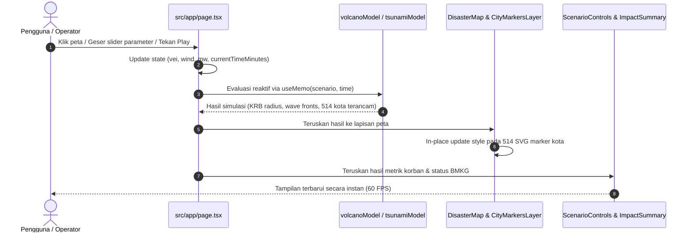

# Dokumentasi Teknis Nusantara Disaster Simulator (`disastersim`)

Dokumen ini merupakan panduan arsitektur dan teknis resmi untuk **Nusantara Disaster Simulator**. Dirancang sebagai rujukan lengkap bagi setiap pengembang yang ingin memahami cara kerja aplikasi, alur data, landasan pemodelan ilmiah, hingga peta detail file dan fitur yang ada di dalam repositori.

---

## Daftar Isi
1. [Ikhtisar Sistem & Filosofi Desain](#1-ikhtisar-sistem--filosofi-desain)
2. [Peta Navigasi Cepat: Fitur vs File](#2-peta-navigasi-cepat-fitur-vs-file)
3. [Bedah Struktur Berkas Lengkap (File-by-File Breakdown)](#3-bedah-struktur-berkas-lengkap-file-by-file-breakdown)
4. [Arsitektur Sistem & Aliran Data Reaktif](#4-arsitektur-sistem--aliran-data-reaktif)
5. [Landasan Ilmiah & Formula Simulasi](#5-landasan-ilmiah--formula-simulasi)
6. [Mesin Peta & Rendering Geospasial Kinerja Tinggi](#6-mesin-peta--rendering-geospasial-kinerja-tinggi)
7. [Komponen Antarmuka Pengguna & Command Center HUD](#7-komponen-antarmuka-pengguna--command-center-hud)
8. [Struktur Pangkalan Data Geologis](#8-struktur-pangkalan-data-geologis)
9. [Rangkaian Pengujian Otomatis & QA](#9-rangkaian-pengujian-otomatis--qa)
10. [Panduan Operasional, Deployment & Arsitektur Biaya](#10-panduan-operasional-deployment--arsitektur-biaya)
11. [Panduan Menambah Fitur Baru](#11-panduan-menambah-fitur-baru)

---

## 1. Ikhtisar Sistem & Filosofi Desain

**Nusantara Disaster Simulator** adalah aplikasi web simulasi cepat untuk memodelkan dampak bahaya geologis di Indonesia—terfokus pada **Letusan Gunung Berapi** dan **Tsunami Megathrust**. Aplikasi ini menyajikan visualisasi taktis dengan gaya ruang kendali darurat (*Emergency Command Center*), mengadopsi standar ilmiah resmi dari **PVMBG** (Pusat Vulkanologi dan Mitigasi Bencana Geologi) dan sistem peringatan dini **BMKG InaTEWS**.

### Tiga Pilar Rekayasa Utama:

1. **100% Client-Side In-Memory Computing**:
   Seluruh pemrosesan fisika (radius Kawasan Rawan Bencana, jangkauan sebaran abu, kecepatan rambat gelombang, amplifikasi pantai, hingga evaluasi keterpaparan 514 kota/kabupaten se-Indonesia) dieksekusi secara instan di peramban pengguna (*browser CPU*). Tidak ada ketergantungan pada backend server, database dinamis, atau API GIS eksternal berbayar.
2. **Zero-Cost Architecture pada Anycast CDN**:
   Seluruh halaman web berstatus *Static Prerendered* (`○`) dan disajikan langsung melalui Edge CDN global Vercel. Tidak ada fungsi serverless (Lambda) yang dipanggil pada setiap permintaan halaman, sehingga biaya operasional hosting bernilai Rp 0 dan kebal terhadap lonjakan trafik tinggi.
3. **Resiliensi Geospasial 60 FPS**:
   Untuk memperbarui status 514 kota setiap detik tanpa membuat peramban tersendat (*stutter* atau *jank*), sistem menerapkan teknik mutasi properti in-place pada elemen SVG Leaflet, menghindari siklus destruksi dan pembuatan ulang DOM.

---

## 2. Peta Navigasi Cepat: Fitur vs File

Tabel berikut menjawab pertanyaan praktis: *"Jika saya ingin mengubah fitur X, berkas mana yang harus saya buka?"*

| Fitur Aplikasi | Berkas Utama | Komponen / Fungsi Kunci |
| :--- | :--- | :--- |
| **Pusat Status Aplikasi (Mode Bencana, Skenario, Waktu)** | [`src/app/page.tsx`](./src/app/page.tsx) | `DisasterSimulatorPage`, status `activeDisaster` |
| **Timer Playback Terpusat (Play/Pause, T+Xm)** | [`src/app/page.tsx`](./src/app/page.tsx) | `useEffect` interval sentral (Single Source of Truth) |
| **Deteksi Cerdas Klik Peta (Laut $\to$ Tsunami, Darat $\to$ Gunung)** | [`src/app/page.tsx`](./src/app/page.tsx) + [`src/lib/geoUtils.ts`](./src/lib/geoUtils.ts) | `handleMapClick`, `isOceanCoordinate` |
| **Slider Parameter Bencana (VEI, Angin, Mw, Kedalaman)** | [`src/components/panels/ScenarioControls.tsx`](./src/components/panels/ScenarioControls.tsx) | `ScenarioControls`, slider input, filter kepulauan |
| **Metrik Korban Terpapar, Status BMKG & Rekomendasi TES** | [`src/components/panels/ImpactSummary.tsx`](./src/components/panels/ImpactSummary.tsx) | `ImpactSummary`, ringkasan populasi, waktu kedatangan |
| **Direktori 514 Kota & Tombol "Fokuskan Peta"** | [`src/components/panels/ImpactSummary.tsx`](./src/components/panels/ImpactSummary.tsx) | Tab daftar kota terancam, `onFlyToCity` |
| **Dock Pengendali Waktu T+0 s.d T+60m (Desktop)** | [`src/components/panels/TimelineBar.tsx`](./src/components/panels/TimelineBar.tsx) | `TimelineBar`, scrubber slider, pemilih speed 1x/2x/5x |
| **Bottom Sheet 3-Tahap & Gestur Sentuh (Mobile)** | [`src/components/panels/MobileBottomSheet.tsx`](./src/components/panels/MobileBottomSheet.tsx) | `MobileBottomSheet`, height state (`peek`/`half`/`full`) |
| **Peta Layar Penuh Leaflet & Basemap Switcher** | [`src/components/map/DisasterMap.tsx`](./src/components/map/DisasterMap.tsx) | `DisasterMap`, `applyBasemap`, floating toolbar |
| **Lapisan Visual Letusan Gunung (KRB I/II/III & Plume Abu)** | [`src/components/map/VolcanoLayers.tsx`](./src/components/map/VolcanoLayers.tsx) | `VolcanoLayers`, polygon KRB, sektor kerucut abu |
| **Lapisan Visual Tsunami (Wave Train & Inundasi Pantai)** | [`src/components/map/TsunamiLayers.tsx`](./src/components/map/TsunamiLayers.tsx) | `TsunamiLayers`, elips gelombang, buffer inundasi |
| **Render 514 Marker Kota Berkinerja Tinggi** | [`src/components/map/CityMarkersLayer.tsx`](./src/components/map/CityMarkersLayer.tsx) | `CityMarkersLayer`, `existingMarker.setStyle` |
| **Generator Unduh Laporan Taktis (PDF & PNG)** | [`src/components/modals/ExportReportModal.tsx`](./src/components/modals/ExportReportModal.tsx) | `ExportReportModal`, `html-to-image`, `jspdf` |
| **Simbol Vektor Kartografi Taktis (Berlian KRB, Episentrum)** | [`src/components/ui/TacticalSymbols.tsx`](./src/components/ui/TacticalSymbols.tsx) | `HazardDiamond`, `SummitPeakIcon`, `SeismicEpicenterIcon` |
| **Kartu Pengarah Mode Siaga (Clean Slate Standby)** | [`src/components/panels/StandbyBriefing.tsx`](./src/components/panels/StandbyBriefing.tsx) | `StandbyBriefing`, pengenalan legenda simbol |
| **Rumus Erupsi Gunung, Kolom Abu & Radius KRB** | [`src/lib/simulation/volcanoModel.ts`](./src/lib/simulation/volcanoModel.ts) | `simulateVolcanoEruption`, tabel `VEI_SPECS` |
| **Rumus Tsunami, Kecepatan $c=\sqrt{gd}$, Papazachos & Green's Law** | [`src/lib/simulation/tsunamiModel.ts`](./src/lib/simulation/tsunamiModel.ts) | `simulateTsunamiImpact`, amplifikasi pantai |
| **Fungsi Geospasial (Haversine, Bearing, Oklusi Daratan)** | [`src/lib/geoUtils.ts`](./src/lib/geoUtils.ts) | `calculateHaversineDistanceKm`, `isLineOccludedByLand` |
| **Sanitasi Keamanan (XSS, Filename Traversal, Clamping Angka)** | [`src/lib/sanitize.ts`](./src/lib/sanitize.ts) | `escapeHtml`, `sanitizeFilename`, `sanitizeNumeric` |
| **Katalog 78 Gunung Api & Puncak Nasional** | [`src/data/volcanoes.ts`](./src/data/volcanoes.ts) | `INDONESIA_VOLCANOES` |
| **Katalog Sesar Megathrust & Hub Pesisir Nasional** | [`src/data/tsunamiFaults.ts`](./src/data/tsunamiFaults.ts) | `INDONESIA_TSUNAMI_FAULTS`, `INDONESIA_COASTAL_REFERENCE_HUBS` |
| **Pangkalan Data 514 Kota & Kabupaten BPS** | [`src/data/indonesiaCities.ts`](./src/data/indonesiaCities.ts) | `INDONESIA_CITIES` (416 Kabupaten + 98 Kota) |
| **Kontrak Tipe TypeScript Global** | [`src/types/disaster.ts`](./src/types/disaster.ts) | Definisi antarmuka skenario, status evaluasi, dan model |

---

## 3. Bedah Struktur Berkas Lengkap (File-by-File Breakdown)

Berikut adalah rincian peran teknis, masukan (*inputs*), keluaran (*outputs*), dan ketergantungan dari setiap berkas kode:

### A. Direktori `src/app/` (Halaman & Konfigurasi Global)

#### 1. `src/app/page.tsx`
* **Peran**: Halaman utama aplikasi dan *root state orchestrator*.
* **State Utama**:
  * `activeDisaster`: `'standby' | 'volcano' | 'tsunami'`.
  * `selectedVolcano` & `volcanoScenario`: Menyimpan preset gunung dan parameter kawah aktif.
  * `selectedFault` & `tsunamiScenario`: Menyimpan preset patahan gempa dan parameter hiposenter.
  * `currentTimeMinutes`: Menit perambatan bencana aktif ($0 - 60\text{ menit}$).
  * `isPlaying` & `playbackSpeed`: Status pemutaran otomatis dan pengali kecepatan.
* **Mekanisme Penting**:
  * Mengisolasi `setInterval` pemutaran waktu secara terpusat agar tidak terjadi *double tick* akibat komponen kontrol desktop dan mobile yang ter-mount bersamaan.
  * Menjalankan kalkulasi simulasi vulkanik dan tsunami secara memoized (`useMemo`).
  * Mengevaluasi status 514 kota secara reaktif setiap kali parameter skenario atau waktu berubah.
  * Merender kanvas Leaflet layar penuh, header navigasi, drawer kiri/kanan desktop, dock bawah desktop, dan bottom sheet mobile.

#### 2. `src/app/layout.tsx`
* **Peran**: Root layout Next.js 15 App Router.
* **Tanggung Jawab**:
  * Mengimpor CSS Leaflet lokal secara mandiri (`import 'leaflet/dist/leaflet.css';`) sehingga aplikasi terbebas dari ketergantungan CDN eksternal `unpkg.com`.
  * Menyematkan metadata SEO dan OpenGraph dalam Bahasa Indonesia baku.
  * Mengatur palet tema latar belakang pekat `#070B14` pada tag `<body>`.

#### 3. `src/app/globals.css`
* **Peran**: Styling kustom global dan optimasi mobile-native.
* **Tanggung Jawab**:
  * Menyediakan utilitas tinggi dinamis `h-[100dvh]` untuk mencegah pergeseran layout saat address bar browser mobile muncul atau hilang.
  * Mengaktifkan `overscroll-behavior-y: none` untuk mencegah *pull-to-refresh* browser memuat ulang halaman secara tidak sengaja.
  * Menghapus efek kedip biru sentuhan lewat `-webkit-tap-highlight-color: transparent`.
  * Memasang aturan font minimal 16px pada elemen formulir layar sempit untuk mematikan fitur auto-zoom iOS Safari.
  * Menyediakan utilitas `.pt-safe` dan `.pb-safe` untuk notch dan home indicator iPhone.

#### 4. `src/app/icon.svg`
* **Peran**: Favicon vektor taktis berbentuk radar cincin api dengan target kawah vulkanik dan gelombang seismik.

---

### B. Direktori `src/components/map/` (Lapisan Geospasial Leaflet)

#### 1. `src/components/map/DisasterMap.tsx`
* **Peran**: Komponen kontainer peta utama.
* **Tanggung Jawab**:
  * Menginisialisasi instance Leaflet (`L.Map`) murni pada sisi klien (`ssr: false` via `next/dynamic`).
  * Mengatur view awal kepulauan Indonesia (`center: [-2.5, 118.0]`, `zoom: 5`, `minZoom: 4`, `maxZoom: 18`).
  * Mengelola ubin basemap aktif: **Esri Dark Gray Canvas** (default), **Esri World Imagery (Satelit)**, dan **OpenStreetMap Standard**.
  * Merender toolbar mengambang atas (`top-[58px] sm:top-16`) dengan tombol view seluruh Indonesia, tombol fokus target bencana, kontrol zoom, dan filter layer.
  * Menghubungkan klik koordinat peta dengan event `onMapClick`.

#### 2. `src/components/map/CityMarkersLayer.tsx`
* **Peran**: Lapisan visual 514 titik kota dan kabupaten di atas peta.
* **Optimasi Kritis**:
  * Menggunakan `Map<string, L.CircleMarker>` untuk menyimpan referensi marker yang sudah dibuat.
  * Saat waktu $T$ bergeser, sistem mengeksekusi `existingMarker.setStyle()` dan `setTooltipContent()` secara in-place. Hal ini mencegah browser membuat 514 elemen DOM SVG baru setiap detik, menjaga FPS tetap stabil di angka 60.
  * Mengikat popup telemetri interaktif dengan data sensus penduduk BPS, jarak kilometer ke sumber bencana, status peringatan, dan tombol fokus navigasi.

#### 3. `src/components/map/VolcanoLayers.tsx`
* **Peran**: Lapisan visual bahaya erupsi gunung berapi.
* **Tanggung Jawab**:
  * Menampilkan 69 pin gunung aktif dengan ikon berlian taktis oranye dan 9 pin non-vulkanik abu-abu.
  * Menggambar tiga poligon lingkaran transparan untuk Kawasan Rawan Bencana (KRB III bahaya tinggi, KRB II sedang, KRB I rendah).
  * Menggambar poligon sektor kerucut dispersi abu vulkanik (*ash plume cone*) sesuai arah dan kecepatan hembusan angin.
  * Menampilkan lokasi Tempat Evakuasi Sementara (TES) aman di luar batas KRB.

#### 4. `src/components/map/TsunamiLayers.tsx`
* **Peran**: Lapisan visual perambatan gelombang tsunami dan ancaman pesisir.
* **Tanggung Jawab**:
  * Menampilkan pin episentrum gempa dengan animasi gelombang seismik berdenyut.
  * Menggambar rentetan muka gelombang (*wave train*) multi-lapisan: puncak primer, sekunder, riak dangkal, dan palung hisap air laut surut.
  * Memotong geometri muka air menggunakan Turf.js (`@turf/difference`) agar gelombang berhenti tepat di bibir pantai daratan pulau.
  * Menyalakan suar benturan pesisir (*impact beacons*) berdenyut saat waktu simulasi mencapai ETA garis pantai ($T \ge \text{ETA}$).
  * Menumbuhkan buffer genangan daratan (*inundation corridor*) seiring bertambahnya waktu pasca-benturan.

---

### C. Direktori `src/components/panels/` (Panel Kendali Taktis HUD)

#### 1. `src/components/panels/ScenarioControls.tsx`
* **Peran**: Panel drawer desktop sebelah kiri untuk mengatur parameter bencana.
* **Tanggung Jawab**:
  * Menyediakan filter gugus pulau (*Semua, Jawa, Sumatera, Bali-NT, Sulawesi, Maluku-Papua, Non-Vulkanik*) dan pencarian teks cepat.
  * Menyediakan slider interaktif indeks VEI (1 s.d 8), arah angin (0–360°), kecepatan angin (10–120 km/jam), magnitudo gempa ($M_w$ 6.5–9.5), dan kedalaman hiposenter (5–100 km).
  * Menyediakan tombol aksi cepat "Dampak Maksimal" dan "Kembalikan Standar".

#### 2. `src/components/panels/ImpactSummary.tsx`
* **Peran**: Panel drawer desktop sebelah kanan untuk analisis dampak dan direktori wilayah.
* **Tanggung Jawab**:
  * Menampilkan kartu status ancaman resmi BMKG/PVMBG, estimasi korban terpapar BPS, dan countdown sisa waktu tiba gelombang.
  * Menampilkan daftar 514 kota dengan filter status (*Terancam*, *Semua*, *Aman*) dan tombol *"Fokuskan"* untuk mengarahkan kamera peta ke kota terkait.
  * Menampilkan daftar Tempat Evakuasi Sementara (TES) terdekat.
  * Menyediakan tombol untuk membuka modal ekspor laporan (*Disaster Impact Brief*).

#### 3. `src/components/panels/TimelineBar.tsx`
* **Peran**: Dock pengontrol perambatan waktu di bagian bawah layar pada antarmuka desktop.
* **Tanggung Jawab**:
  * Menyediakan slider waktu perambatan dinamis dari $T+0\text{m}$ hingga $T+60\text{m}$.
  * Menyediakan tombol Play/Pause dan pemilih kecepatan (1x, 2x, 5x).
  * Menampilkan teks fase kejadian bencana secara dinamis.

#### 4. `src/components/panels/MobileBottomSheet.tsx`
* **Peran**: Antarmuka terpadu untuk layar seluler dan tablet compact ($< 768\text{px}$).
* **Tanggung Jawab**:
  * Mengintegrasikan fungsi parameter simulasi, ringkasan dampak, dan timeline scrubber ke dalam satu panel geser bawah.
  * Memiliki 3 mode ketinggian: `peek` (68px), `half` (52dvh), dan `full` (86dvh).
  * Mengisolasi deteksi gestur sentuh (`onTouchStart`, `onTouchEnd`) pada handle atas dengan ambang batas geser 40px, sehingga tidak mengganggu kemampuan scroll daftar kota di dalam tab.
  * Otomatis menurunkan ketinggian dari `full` ke `half` saat pengguna menekan kota di tab dampak agar animasi kamera peta terlihat.

#### 5. `src/components/panels/StandbyBriefing.tsx`
* **Peran**: Kartu panduan operasional saat aplikasi berada dalam status default *Clean Slate Standby Mode*.

---

### D. Direktori `src/components/modals/` & `src/components/ui/`

#### 1. `src/components/modals/ExportReportModal.tsx`
* **Peran**: Kotak dialog generator ringkasan dampak bencana resmi berstandar BNPB.
* **Tanggung Jawab**:
  * Merender pratinjau dokumen laporan komando darurat.
  * Mengunduh berkas dalam format PDF menggunakan `jspdf` atau gambar PNG resolusi tinggi ($2\times$ pixel ratio) menggunakan `html-to-image`. Seluruh proses berjalan di peramban klien tanpa beban server.

#### 2. `src/components/ui/TacticalSymbols.tsx`
* **Peran**: Koleksi simbol kartografi vektor SVG kustom sesuai standar pemetaan geologi (Berlian KRB PVMBG, Puncak Gunung, dan Episentrum Seismik).

---

### E. Direktori `src/lib/` (Mesin Simulasi & Logika Matematis)

#### 1. `src/lib/simulation/volcanoModel.ts`
* **Peran**: Mesin kalkulasi ilmiah dampak erupsi vulkanik.
* **Tanggung Jawab**:
  * Menyimpan tabel spesifikasi VEI 1–8.
  * Menghitung tinggi kolom letusan via rumus Wilson & Mastin.
  * Menghitung radius KRB I, II, dan III.
  * Menghitung jangkauan sebaran abu bertingkat (Tebal, Sedang, Tipis) berdasarkan kecepatan angin.
  * Menghitung jarak Haversine ke 514 kota dan menentukan status keterpaparan kota.

#### 2. `src/lib/simulation/tsunamiModel.ts`
* **Peran**: Mesin kalkulasi ilmiah perambatan tsunami tektonik.
* **Tanggung Jawab**:
  * Menghitung kecepatan rambat gelombang laut dalam: $c = \sqrt{g \cdot d}$.
  * Menghitung tinggi gelombang inisial di episentrum via formula Papazachos.
  * Menghitung waktu kedatangan gelombang (ETA) pada hub pesisir.
  * Menghitung amplifikasi pesisir via Hukum Green (*Green's Law*).
  * Mengklasifikasikan status peringatan BMKG InaTEWS (*WASPADA*, *SIAGA*, *AWAS*).
  * Menyaring keterpaparan daratan lewat algoritma penapisan oklusi darat (*land occlusion*).

#### 3. `src/lib/geoUtils.ts`
* **Peran**: Modul fungsi trigonometri bola bumi dan matematika spasial murni.
* **Fungsi Kunci**:
  * `calculateHaversineDistanceKm`: Jarak busur permukaan bumi antara 2 koordinat.
  * `calculateBearingDeg`: Sudut arah kompas (azimuth) dari titik asal ke target.
  * `degreeToCompassIndonesian`: Konversi derajat ke nama 8 mata angin baku Indonesia.
  * `createWedgeSectorPolygon`: Poligon sektor kerucut untuk visualisasi sebaran abu.
  * `isOceanCoordinate`: Deteksi apakah koordinat berada di lautan atau daratan nusantara.
  * `isLineOccludedByLand`: Pemeriksaan apakah lintasan gelombang terhalang pulau besar.

#### 4. `src/lib/sanitize.ts`
* **Peran**: Modul keamanan sanitasi data.
* **Fungsi Kunci**:
  * `escapeHtml`: Mencegah injeksi skrip XSS pada tooltip dan popup Leaflet.
  * `sanitizeFilename`: Mencegah celah path traversal pada penamaan file ekspor PDF/PNG.
  * `sanitizeNumeric`: Melakukan *clamping* batas aman dan fallback terhadap nilai `NaN`/`Infinity`.

---

### F. Direktori `src/data/` (Pangkalan Data Geologis Statis)

#### 1. `src/data/volcanoes.ts`
* **Peran**: Katalog 78 gunung api dan puncak pegunungan di Indonesia (69 gunung aktif tipe A/B + 9 puncak non-vulkanik), mencakup koordinat, elevasi, provinsi, gugus pulau, dan VEI default.

#### 2. `src/data/tsunamiFaults.ts`
* **Peran**: Katalog zona subduksi megathrust dan sesar aktif utama Indonesia, kedalaman rata-rata lantai laut, serta daftar 40+ titik hub pesisir dan Tempat Evakuasi Sementara (TES).

#### 3. `src/data/indonesiaCities.ts`
* **Peran**: Pangkalan data lengkap 514 Kota dan Kabupaten di 38 Provinsi di Indonesia (416 Kabupaten + 98 Kota) sesuai sensus BPS dan Kemendagri terbaru, mencakup koordinat sentroid, estimasi penduduk, dan penanda wilayah pesisir (*isCoastal*).

---

### G. Direktori `scripts/` (Automated Test Suites)

#### 1. `scripts/run100Scenarios.ts`
* **Peran**: Audit otomatis 100 skenario bencana ekstrem (50 erupsi vulkanik, 40 skenario tsunami megathrust, 10 skenario kustom lepas pantai) untuk memverifikasi akurasi matematis tanpa nilai `NaN` dan latensi di bawah 10 ms per pengujian.

#### 2. `scripts/test_geometry_integrity.ts`
* **Peran**: Pengujian integritas koordinat spasial 514 kota (validasi rentang teritorial kepulauan Indonesia, simetri sudut lingkaran, dan toleransi kalkulasi Haversine).

#### 3. `scripts/test_security_sanitization.ts`
* **Peran**: Pengujian keamanan terhadap serangan DOM XSS, path traversal nama file unduhan, dan injeksi parameter numerik rusak (`NaN`/`Infinity`).

---

## 4. Arsitektur Sistem & Aliran Data Reaktif

Sistem menggunakan arsitektur aliran data satu arah (*unidirectional reactive data flow*):



### Mekanisme Siklus Waktu & Timer Sentral
Saat tombol Play ditekan pada dock bawah atau mobile sheet:
1. `isPlaying` bernilai `true`.
2. Timer tunggal pada `src/app/page.tsx` memicu penambahan `currentTimeMinutes` dari menit ke-0 hingga menit ke-60 dengan interval waktu yang disesuaikan terhadap `playbackSpeed` (1x, 2x, 5x).
3. Karena `currentTimeMinutes` berubah, fungsi `simulateTsunamiImpact(scenario, currentTimeMinutes)` dieksekusi ulang secara instan.
4. Jarak muka gelombang bertambah, status garis pantai diperiksa ulang, dan 514 titik kota diperbarui warnanya.

---

## 5. Landasan Ilmiah & Formula Simulasi

### A. Fisika Erupsi Vulkanik (PVMBG Standard)

#### 1. Indeks Daya Ledak Erupsi (VEI)
Skala logaritmik dari VEI 1 (Efusif, volume tephra $10^{-4}\text{ km}^3$) hingga VEI 8 (Mega-Kolosal Kaldera Toba, volume tephra $>1000\text{ km}^3$).

#### 2. Estimasi Tinggi Kolom Erupsi (Wilson & Mastin)
$$H = 2.0 \cdot V^{0.241}$$
Di mana $H$ adalah tinggi kolom abu (km) dan $V$ adalah volume tephra padat yang dilontarkan ($10^6\text{ m}^3$).

#### 3. Zonasi Kawasan Rawan Bencana (KRB)
Radius bahaya dikalibrasi terhadap pengali indeks letusan ($M_{\text{VEI}}$):
* **KRB III (Zona Merah / Bahaya Sangat Tinggi)**: $R_{\text{KRB3}} = R_{\text{base3}} \cdot M_{\text{VEI}}$. Kawasan terancam luncuran awan panas guguran (*pyroclastic density currents*), lontaran batu pijar, dan gas beracun.
* **KRB II (Zona Oranye / Bahaya Sedang)**: $R_{\text{KRB2}} = R_{\text{base2}} \cdot M_{\text{VEI}} \cdot 1.6$. Kawasan berpotensi tertimpa lontaran batu pijar dan hujan abu lebat.
* **KRB I (Zona Kuning / Bahaya Rendah)**: $R_{\text{KRB1}} = R_{\text{base1}} \cdot M_{\text{VEI}} \cdot 2.4$. Kawasan perluasan banjir lahar dingin dan sebaran abu vulkanik.

#### 4. Dispersi Abu Tephra Bertingkat (*Isopach Plume*)
* Jangkauan maksimal sebaran abu:
  $$L_{\text{ash}} = (H_{\text{kolom}} \cdot 2.2) + (v_{\text{angin}} \cdot 0.85) \cdot M_{\text{VEI}}^{0.6}$$
* Apertur sudut kerucut sebaran abu menyesuaikan kecepatan hembusan angin:
  $$\alpha = \max\left(25^\circ, 70^\circ - (v_{\text{angin}} \cdot 0.35)\right)$$
* Sebaran dibagi menjadi tiga lapisan konsentrasi: Abu Tebal ($>5\text{ cm}$, radius $30\%$), Abu Sedang ($1–5\text{ cm}$, radius $65\%$), dan Abu Tipis ($<1\text{ cm}$, radius $100\%$).

---

### B. Fisika Tsunami Tektonik & Gempa Megathrust (BMKG Standard)

#### 1. Kecepatan Rambat Gelombang Laut Dalam (*Shallow-Water Wave Equation*)
Karena panjang gelombang tsunami ($\lambda > 100\text{ km}$) jauh lebih panjang daripada kedalaman samudera ($d$), gelombang tsunami mematuhi persamaan gelombang air dangkal:
$$c = \sqrt{g \cdot d}$$
Di mana $g = 9.81\text{ m/s}^2$ dan $d$ adalah kedalaman rata-rata samudera ($3.800\text{ m}$).
Kecepatan rambat rata-rata di Palung Jawa adalah $c \approx 695\text{ km/jam}$.

#### 2. Ketinggian Gelombang Inisial di Episentrum (Formula Papazachos)
$$\log_{10}(H_0) = 0.55 \cdot M_w - 0.005 \cdot D - 3.85$$
$$H_0 = \max\left(0.2, 10^{\log_{10}(H_0)}\right)\text{ meter}$$
Di mana $M_w$ adalah magnitudo momen gempa dan $D$ adalah kedalaman hiposenter gempa dalam kilometer.

#### 3. Amplifikasi Gelombang di Pantai Dangkal (Hukum Green / *Green's Law*)
Saat gelombang mencapai perairan pantai dangkal ($d_{\text{dangkal}} \approx 10\text{ meter}$), laju gelombang melambat dan energi kinetik berubah menjadi lonjakan vertikal:
$$H_{\text{pantai}} = H_0 \cdot \left(\frac{d_{\text{dalam}}}{d_{\text{dangkal}}}\right)^{1/4}$$
Rasio amplifikasi di perairan pantai Indonesia mencapai $\approx 4.41\times$ tinggi inisial di tengah laut.

#### 4. Klasifikasi Tingkat Bahaya Peringatan Dini BMKG InaTEWS
* **WASPADA (Kuning)**: Estimasi tinggi pantai $< 0.5\text{ meter}$. Tindakan: Menjauhi pantai dan bantaran muara sungai.
* **SIAGA (Oranye)**: Estimasi tinggi pantai $0.5 - 3.0\text{ meter}$. Tindakan: Evakuasi segera ke tempat tinggi di atas 10 meter.
* **AWAS (Merah)**: Estimasi tinggi pantai $> 3.0\text{ meter}$. Tindakan: Evakuasi menyeluruh ke shelter TES darurat tingkat tinggi.

#### 5. Algoritma Oklusi Daratan (*Land Occlusion Filter*)
Fungsi `isLineOccludedByLand(lat1, lng1, lat2, lng2)` menerapkan teknik *ray-casting line intersection* terhadap batas daratan pulau-pulau besar Indonesia (Sumatera, Jawa, Kalimantan, Sulawesi). Hal ini menjamin gelombang tsunami di Samudera Hindia (selatan Jawa) tidak menembus daratan dan keliru menerjang kota di Laut Jawa (pantai utara).

---

## 6. Mesin Peta & Rendering Geospasial Kinerja Tinggi

### A. Integrasi Next.js 15 & Leaflet.js
Leaflet membutuhkan akses langsung ke objek global peramban `window`. Di dalam Next.js App Router, komponen peta diimpor secara dinamis dengan mematikan SSR:

```typescript
const DisasterMap = dynamic(() => import('@/components/map/DisasterMap'), {
  ssr: false,
  loading: () => <MapLoadingIndicator />,
});
```

### B. Teknik Mutasi In-Place pada 514 Titik Kota
Di dalam [`src/components/map/CityMarkersLayer.tsx`](./src/components/map/CityMarkersLayer.tsx), sistem menyimpan referensi setiap marker dalam `markersMapRef`:

```typescript
const existingMarker = markersMap.get(city.id);
if (existingMarker) {
  // Mutasi properti in-place: menghindari destruksi dan alokasi DOM baru
  existingMarker.setStyle({
    radius,
    fillColor: color,
    fillOpacity,
  });
  existingMarker.setTooltipContent(tooltipHtml);
  existingMarker.setPopupContent(popupHtml);
} else {
  // Hanya dibuat satu kali pada mount awal
  const marker = LModule.circleMarker([city.lat, city.lng], { ... });
  layerGroup.addLayer(marker);
  markersMap.set(city.id, marker);
}
```

### C. Pemotongan Geometri Turf.js (`@turf/difference`)
Untuk mencegah poligon gelombang tsunami menembus ke sisi seberang daratan pulau, poligon cincin elips gelombang dipotong menggunakan operasi Boolean geospasial terhadap garis pantai daratan nusantara.

---

## 7. Komponen Antarmuka Pengguna & Command Center HUD

### A. Anatomi Tata Letak Desktop ($\ge 768\text{px}$)
1. **Floating Command Header**: Menampilkan branding radar pulse berdenyut, pemilih mode bencana terpusat, status FPS in-memory, dan tombol unduh laporan.
2. **Left HUD Drawer (`ScenarioControls`)**: Pengaturan parameter, pemilih katalog gunung/sesar, dan slider fisik.
3. **Right HUD Drawer (`ImpactSummary`)**: Kartu metrik korban terdampak, status resmi BMKG, direktori 514 kota dengan tombol *"Fokuskan"*, dan rekomendasi posko TES.
4. **Bottom Floating Dock (`TimelineBar`)**: Pengendali perambatan waktu dinamis $T+0$ s.d $T+60\text{m}$.

### B. Mobile Interactive Bottom Sheet ($< 768\text{px}$)
Komponen [`src/components/panels/MobileBottomSheet.tsx`](./src/components/panels/MobileBottomSheet.tsx) menyediakan kontrol ergonomis satu jempol:
* **Mode Peek (`h-[68px]`)**: Menampilkan tombol Play/Pause, badge $T+X\text{m}$, mini time scrubber, tab switcher (Parameter / Dampak), dan tombol ekspansi. Peta terlihat 90%.
* **Mode Half (`h-[52dvh]`)**: Menampilkan separuh peta di atas dan form slider parameter atau daftar dampak di bawah.
* **Mode Full (`h-[86dvh]`)**: Layar penuh untuk membaca laporan detail dan direktori 514 kota.
* **Deteksi Gestur Sentuh**: Event `onTouchStart` dan `onTouchEnd` dipasang secara eksklusif pada handle atas (tinggi 68px) dengan ambang batas pergeseran $\Delta Y = 40\text{px}$. Hal ini mencegah konflik saat pengguna menggulir daftar kota di dalam konten sheet.

---

## 8. Struktur Pangkalan Data Geologis

Seluruh pangkalan data disimpan dalam struktur TypeScript murni di `src/data/`:

### A. Katalog 78 Gunung Api & Puncak ([`src/data/volcanoes.ts`](./src/data/volcanoes.ts))
Tipe data `VolcanoPreset`:
```typescript
interface VolcanoPreset {
  id: string;
  name: string;
  category: 'active_volcano' | 'non_volcano';
  islandGroup: 'Jawa' | 'Sumatera' | 'Bali-NT' | 'Sulawesi' | 'Maluku-Papua';
  lat: number;
  lng: number;
  elevationM: number;
  defaultVEI: number;
  description: string;
  province: string;
}
```

### B. Katalog Sesar Megathrust & Hub Pesisir ([`src/data/tsunamiFaults.ts`](./src/data/tsunamiFaults.ts))
Tipe data `TsunamiFaultPreset`:
```typescript
interface TsunamiFaultPreset {
  id: string;
  name: string;
  lat: number;
  lng: number;
  strikeAngleDeg: number;
  defaultMw: number;
  defaultDepthKm: number;
  avgOceanDepthM: number;
  nearestCoastDistanceKm: number;
}
```

### C. Pangkalan Data 514 Kota & Kabupaten ([`src/data/indonesiaCities.ts`](./src/data/indonesiaCities.ts))
Tipe data `CityData`:
```typescript
interface CityData {
  id: string;
  name: string;
  type: 'Kota' | 'Kabupaten';
  province: string;
  islandGroup: 'Jawa' | 'Sumatera' | 'Bali-Nusa Tenggara' | 'Kalimantan' | 'Sulawesi' | 'Maluku' | 'Papua';
  lat: number;
  lng: number;
  population: number;
  isCoastal: boolean;
}
```

---

## 9. Rangkaian Pengujian Otomatis & QA

Repositori dilengkapi rangkaian tes otomatis tanpa dependensi server eksternal:

### 1. Menjalankan Seluruh Pengujian
```bash
npm run test
```
Perintah ini mengeksekusi 4 tahap pengujian berurutan:
1. `npx tsc --noEmit`: Pengecekan keutuhan seluruh tipe data TypeScript.
2. `npm run test:security`: Eksekusi berkas [`scripts/test_security_sanitization.ts`](./scripts/test_security_sanitization.ts) (21 skenario uji lulus: sanitasi XSS tooltip, path traversal berkas unduhan, dan injeksi nilai `NaN`/`Infinity`).
3. `npm run test:integrity`: Eksekusi berkas [`scripts/test_geometry_integrity.ts`](./scripts/test_geometry_integrity.ts) (12 skenario uji lulus: validasi keutuhan 514 kota, batasan koordinat teritorial Indonesia, akurasi Haversine, dan simetri sudut lingkaran).
4. `npm run audit`: Eksekusi berkas [`scripts/run100Scenarios.ts`](./scripts/run100Scenarios.ts) (100 skenario simulasi ekstrem: 50 letusan gunung, 40 tsunami tektonik, 10 skenario kustom lepas pantai dengan tingkat kelulusan 100.0% dan rata-rata latensi $< 5\text{ ms}$ per skenario).

---

## 10. Panduan Operasional, Deployment & Arsitektur Biaya

### A. Mengapa Biaya Operasional di Vercel Rp 0?
1. **Zero Serverless Compute**: Halaman `/` berstatus `○ (Static)` (prerendered as static content). Tidak ada fungsi serverless Lambda yang dibangun atau dipanggil per request.
2. **Kapasitas Bandwidth Luas**: Bundel aplikasi hanya sebesar ~176 kB (Brotli compressed). Batas kuota gratis Vercel Hobby sebesar 100 GB/bulan sanggup menampung lebih dari **500.000 kunjungan halaman per bulan**.
3. **Ubin Peta Berjalan Langsung dari Browser Pengguna**: Pengunduhan ubin peta Esri Dark Gray dilakukan langsung dari browser pengguna ke server ArcGIS Esri, **tidak melalui proksi Vercel**, sehingga tidak mengonsumsi kuota bandwidth hosting Anda.

### B. Keamanan & Versi Dependensi
* **Next.js 15.5.28**: Versi rilis patch resmi yang telah menutup seluruh celah keamanan (CVE / GHSA Security Advisories).
* **Self-Hosted Leaflet CSS**: File CSS Leaflet diimpor dari modul lokal `node_modules/leaflet/dist/leaflet.css`, mengeliminasi ketergantungan pada CDN publik pihak ketiga `unpkg.com`.
* **Content Security Policy (CSP)**: Dikonfigurasi secara ketat pada [`next.config.ts`](./next.config.ts) dengan mengunci izin sumber script, style, font, dan koneksi hanya ke domain resmi Esri dan OpenStreetMap.

---

## 11. Panduan Menambah Fitur Baru

### Menambahkan Gunung Api Baru ke Katalog
1. Buka berkas [`src/data/volcanoes.ts`](./src/data/volcanoes.ts).
2. Tambahkan entri baru pada array `INDONESIA_VOLCANOES`:
   ```typescript
   {
     id: 'nama-gunung',
     name: 'Gunung Contoh',
     category: 'active_volcano',
     islandGroup: 'Jawa',
     lat: -7.1234,
     lng: 110.5678,
     elevationM: 2800,
     defaultVEI: 3,
     description: 'Deskripsi geologis dan riwayat letusan dari PVMBG.',
     province: 'Jawa Tengah',
   }
   ```
3. Jalankan `npm run test` untuk memastikan integritas data tetap terjaga.

### Menambahkan Zona Sesar Megathrust Baru
1. Buka berkas [`src/data/tsunamiFaults.ts`](./src/data/tsunamiFaults.ts).
2. Tambahkan entri baru pada array `INDONESIA_TSUNAMI_FAULTS`:
   ```typescript
   {
     id: 'megathrust-contoh',
     name: 'Sunda Megathrust — Segmen Contoh',
     lat: -8.500,
     lng: 112.500,
     strikeAngleDeg: 285,
     defaultMw: 8.5,
     defaultDepthKm: 20,
     avgOceanDepthM: 4000,
     nearestCoastDistanceKm: 75,
   }
   ```
3. Jalankan `npm run test` untuk memverifikasi kalkulasi propagasi.
